# Deep Learning practicals

My work for the assessed practicals of the Deep Learning module (COMP3801, Durham University, 2026/27).
Each practical gives a small starter model and a fixed scoring procedure, and asks for the best score that
can be reached inside tight limits. This repository holds my final solution to each one, a single Python
file per practical. The results are shown in the figures on this page. The briefs, the starter programs,
the datasets and the output of the final runs are not included.

## Results so far

<picture>
  <source media="(prefers-color-scheme: dark)" srcset="docs/figures/overview-dark.png">
  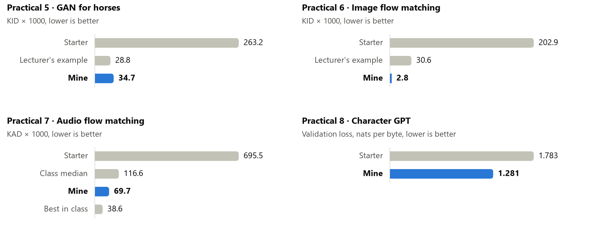
</picture>

Lower is better for practicals 5 to 8. For practical 9 higher is better.

| Practical | Task | Score | Starter | Mine |
|---|---|---|---|---|
| [5](practical-5-gan/) | GAN that generates CIFAR-10 horses | KID × 1000 | 263.2 | **34.7** |
| [6](practical-6-image-flow-matching/) | Flow matching that generates CIFAR-10 horses | KID × 1000 | 202.9 | **2.8** |
| [7](practical-7-audio-flow-matching/) | Flow matching that generates spoken digits | KAD × 1000 | 695.5 | **69.7** |
| [8](practical-8-character-gpt/) | Character-level GPT on Shakespeare | Validation NLL, nats per byte | 1.783 | **1.281** |
| [9](practical-9-implicit-neural-representations/) | Networks that store two photographs, an audio clip and a video in 1 MiB each | Mean PSNR, decibels | 26.7 | **64.5** |

The lecturer's own example solutions scored 28.8 on practical 5 and 30.6 on practical 6. Practical 7 has
been marked: 69.7 was 7th of 142 submissions, against a class median of 116.6 and a best of 38.6.
Practicals 8 and 9 had not been marked when this was written (25 November 2026).

## The rules practicals 5 to 8 share

- At most 1,000,000 parameters and buffer elements in total.
- A fixed number of optimiser updates (10,000, or 20,000 for practical 6) with a batch size of at most 64.
- Training from fresh weights on the supplied training split only: no extra data, pretrained models,
  distillation teachers or gradient accumulation.
- The supplied scoring and sampling code stays as it is. The program writes a results file and samples,
  and these are submitted unchanged.
- An abstract, references and an AI acknowledgement go in comments at the top of the program.

Practical 9 keeps the last three rules but has different limits: at most 1 MiB of saved model state per
signal, and no cap on the batch size or the number of updates.

## What is in the repository

Each practical folder holds one file, `solution.py`. The comments at its top give an abstract of the method,
the references and an acknowledgement of AI use. `docs/figures/` holds the pictures on this page.

The student number in each file has been replaced by the starter's placeholder, so set `STUDENT_ID` near the
top of a file before running it.

## Practical 5: a GAN for horses

A DCGAN trained on the 4,000 horse images of CIFAR-10 and scored with KID against 1,000 validation images.

| Real horses | Starter | Mine |
|:---:|:---:|:---:|
| 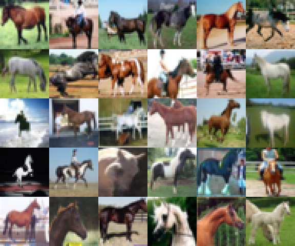 | 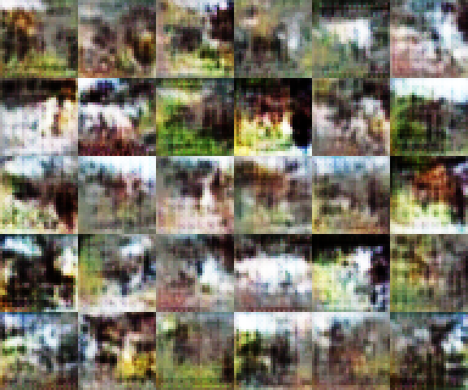 | 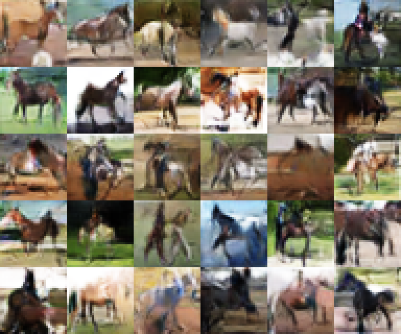 |
| | KID × 1000 = 222 when re-run on my machine (263.2 in the brief) | KID × 1000 = 34.7 |

Each panel is the top-left corner of the first sheet of samples, not a hand-picked selection.

What I changed in [solution.py](practical-5-gan/solution.py):

- Both networks are wider (96 and 128 channels; 925,734 parameters and buffers). The generator normalises
  its first 8×8 features and upsamples with nearest-neighbour resizing followed by 3×3 convolutions.
- The learning rate decays linearly to zero over the second half of training.
- Half the real images are mirrored, and every image the discriminator sees, real or generated, is shifted
  by up to 4 pixels.
- Adaptive discriminator augmentation switches on in the second half of training. Its strength follows how
  confident the discriminator is on real images, with a target of 0.3 rather than the paper's 0.6, because
  the shifts already keep that signal low.

The final run scored 34.7. My test runs ranged from 29.3 to 39.4 (mean 35.2), against a mean of 39.0
without the adaptive augmentation. Apart from the student number, solution.py differs from the code of
that run by one line of the acknowledgement comment, which I reworded afterwards.

## Practical 6: image flow matching

The same horses, generated by flow matching: a network learns the velocity that carries noise to an image,
and the supplied sampler follows it in 50 steps.

| Real horses | My GAN from practical 5 | My flow-matching model |
|:---:|:---:|:---:|
|  |  | 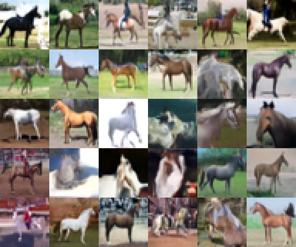 |
| | KID × 1000 = 34.7 | KID × 1000 = 2.8 |

What I changed in [solution.py](practical-6-image-flow-matching/solution.py):

- A U-Net of 48-channel residual blocks at 32×32 and 16×16 with self-attention in every 16×16 block
  (922,803 parameters).
- Training times drawn from a logit-normal distribution shifted towards low noise, inputs scaled to unit
  variance, a warm-up then cosine learning rate, and a moving average of the weights for sampling.
- Autoguidance with no extra parameters: at each sampling step the prediction is pushed away from a
  weakened copy of the same network, one that skips its two middle residual branches. Guidance is applied
  only at low noise levels.

<picture>
  <source media="(prefers-color-scheme: dark)" srcset="docs/figures/practical-6-steps-dark.png">
  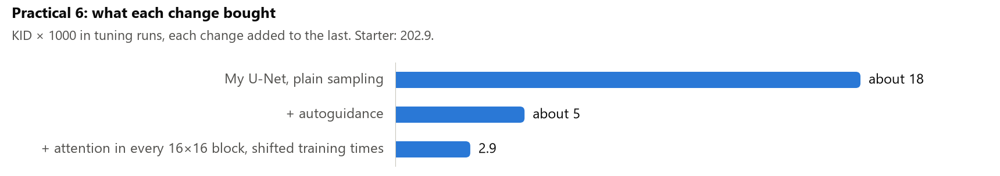
</picture>

Guidance was the largest single gain. Measuring precision and recall of the samples then showed that image
quality already matched the real data while variety did not. Adding the attention layers, which let each
part of the image see the whole picture, made the samples more varied and took the score to about 3.

The final version scored 2.5 in its first run and 2.8 when I ran the same file again. The first version,
with attention only in the middle of the network, scored 5.1.

## Practical 7: audio flow matching

Flow matching again, but for speech: the model generates 128×64 spectrograms of two voices saying the digits
one to nine, a fixed Griffin-Lim routine turns each spectrogram into audio, and the audio is scored with KAD
through a frozen speech encoder. There are only 540 training recordings.

<picture>
  <source media="(prefers-color-scheme: dark)" srcset="docs/figures/practical-7-spectrograms-dark.png">
  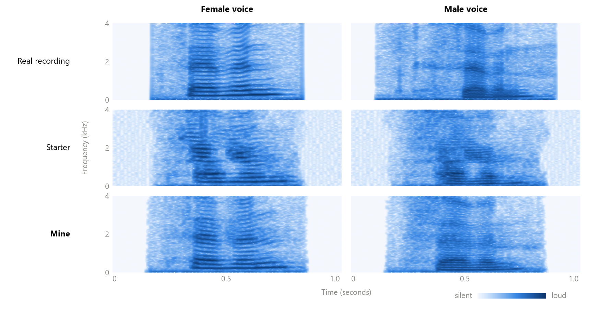
</picture>

The word "seven". The real recordings are exactly silent before and after the word. The starter's output is
blurrier and fills that silence with faint hiss, the haze across its panels, and the scoring punishes the
hiss heavily. Mine leaves the silence silent. The colour scale spans 100 decibels so that the hiss shows.

What I changed in [solution.py](practical-7-audio-flow-matching/solution.py):

- **Network.** A U-Net over patches that are four frequency bins high and one time frame wide, conditioned
  on the flow time, digit and voice in every block, with self-attention at the coarse resolution
  (900,676 parameters). The one-frame width matters: the same network over two-frame patches scored about
  86 instead of about 66.
- **Training.** A quarter of the training times are drawn uniformly so that the first sampling steps, which
  decide how long the word is, get trained. There is no dropout, since a closer fit scored better.
- **Preprocessing of the training spectrograms.** The stored spectrograms clamp silence at a floor that the
  audio conversion turns into the hiss shown above, and the scoring is very sensitive to it: the real
  training spectrograms, converted the same way, score about 210, and about 65 once the floor is lowered.
  Silencing the lowest frequency row as well brings them to about 46. I apply both steps to the training
  images. The lecturer confirmed during the practical that preprocessing the training spectrograms is
  allowed.

<picture>
  <source media="(prefers-color-scheme: dark)" srcset="docs/figures/practical-7-steps-dark.png">
  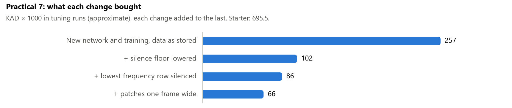
</picture>

Scores of this program vary from run to run even with the fixed seed: tuning runs averaged about 68, with
single results between 54 and 85. The first final run scored 57.7 and a second run of the same file scored
69.7. The second is the one I uploaded.

Other versions I ran:

| Version | KAD × 1000 |
|---|---|
| First run of the final program | 57.7 |
| Earlier version with two-frame patches | 85.8 |
| Final network trained on the spectrograms exactly as stored | 244.0 |

## Practical 8: a character-level GPT

A small GPT predicts the next byte of Shakespeare from the previous 256 bytes, scored by its average
negative log-likelihood on held-out text. The training text has only 0.9 million bytes and is seen about
180 times, so every model memorises it and becomes over-confident on new text. Most of the work went into
that problem.

What I changed in [solution.py](practical-8-character-gpt/solution.py):

- **Dropout stays on at test time.** The model returns the average of its predictions under 64 random
  dropout masks, which acts as an ensemble that costs no parameters.
- **Data augmentation.** Speaker names that never appear in the training text are 2% of the validation
  bytes but 5% of the loss, and unseen words cost more than their share too. In every training window one
  in ten longer words is replaced by a made-up word, and in 30% of windows every speaker is given a made-up
  name. Both are spliced together from pieces of the training text itself.
- **A copy head.** The model can look back at earlier positions that resemble the current one and copy the
  byte that followed, so a new name can be repeated once it has appeared.
- Rotary position encoding, a gated MLP, tied input and output embeddings, a constant learning rate after
  warm-up and a moving average of the weights (six blocks of width 112; 940,726 parameters).

<picture>
  <source media="(prefers-color-scheme: dark)" srcset="docs/figures/practical-8-steps-dark.png">
  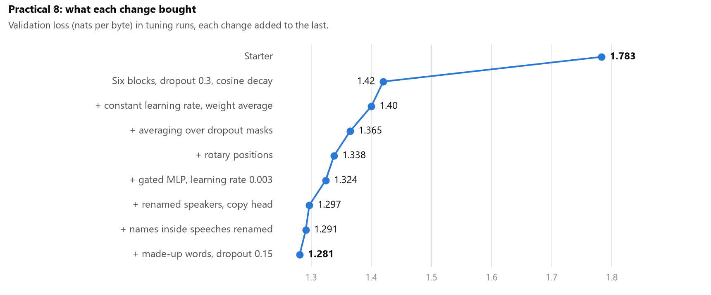
</picture>

<details>
<summary>The same numbers as a table</summary>

| Step | Validation NLL |
|---|---|
| Starter | 1.783 |
| Six blocks, dropout 0.3, cosine decay | 1.42 |
| Constant learning rate and weight average | 1.40 |
| Averaging over dropout masks | 1.365 |
| Rotary positions | 1.338 |
| Gated MLP, learning rate 0.003 | 1.324 |
| Renamed speakers and copy head | 1.297 |
| Names inside speeches renamed too | 1.291 |
| Made-up words, dropout lowered to 0.15 | 1.281 |

</details>

The final run scored **1.2810**. Below is the opening of the first generated passage from each model, with
the same seed. The starter:

```
ROMEO:
 the of dit shall bodgine thusbare far,
Less thy beggare enter.

BRUTUS:
I will of York:
Thou heave marcian my makes of the sover circh, he bass'd,
Go the stard's in matter.
```

Mine:

```
ROMEO:
 Saint Paris Paris and her suspect from thee,
And that my mind cheers have we desired
The root of great Volscians. Our gentlemen,
The grief upon the ship of Bringham and thee?
Our apollot, stander back.

Nurse:
Out, Master shall be dangerous!
```

Two earlier versions scored worse: the same network on the unedited training text (1.3131) and the first
version (1.3595).

Things that did not help include ensembles of several smaller GPTs inside the parameter limit, recurrent or
convolutional layers in front of the transformer, deeper and thinner networks, sharing weights between
blocks, and stronger weight decay.

## Practical 9: networks that store images, video and sound

A network maps a coordinate to a value: a pixel position to a colour, a moment to an audio amplitude, or a
position and a moment to the colour of a video pixel. One network is fitted to each of four signals, and its
saved state may take at most 1 MiB (1,048,576 bytes) per signal. The score is PSNR over every sample, so
this is a compression task. 1 MiB is 3 bits per pixel for the parrot photograph, 8 for the crow, 27 bits
per audio sample for seven seconds of Bach, and only 0.12 bits per pixel for the cat video.

<picture>
  <source media="(prefers-color-scheme: dark)" srcset="docs/figures/practical-9-scores-dark.png">
  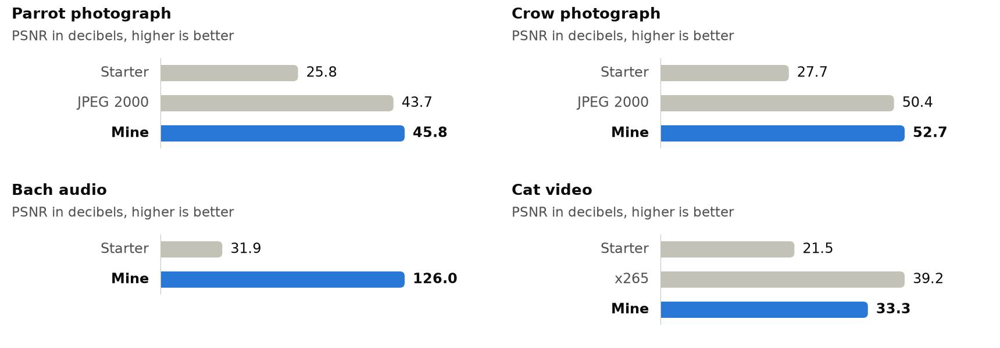
</picture>

JPEG 2000 and x265 are ordinary codecs given the same 1 MiB. I measured them for comparison; they are not
part of the practical.

| | Original | Starter | Mine |
|:---:|:---:|:---:|:---:|
| Parrot | 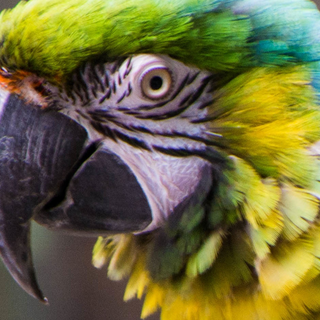 | 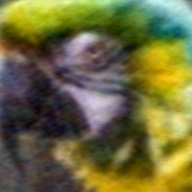 |  |
| | | 25.8 dB | 45.8 dB |
| Crow | 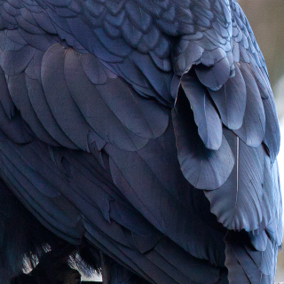 | 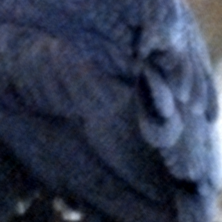 |  |
| | | 27.7 dB | 52.7 dB |

Each picture is the same 320×320 region at full resolution.

| | Frames 3, 90, 181 and 240 of the 272 |
|:---:|:---:|
| Original | 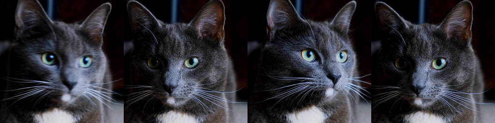 |
| Starter, 21.5 dB | 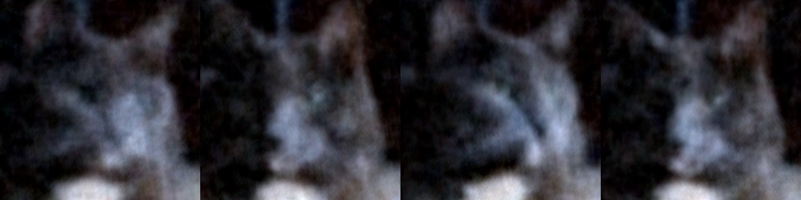 |
| Mine, 33.3 dB | 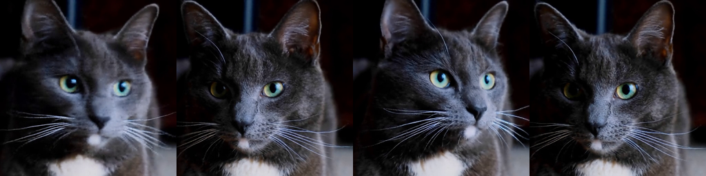 |

What I changed in [solution.py](practical-9-implicit-neural-representations/solution.py):

- **What is stored.** Each signal is a stack of grids of whole numbers, from one cell per sample to one
  cell per 64 samples, and a small network that turns the values read from the grids at a coordinate into
  the output. This is how the neural codecs COOL-CHIC and C3 store an image. The numbers are compressed
  with LZMA into the saved file, and scoring rebuilds everything from that file alone.
- **Training.** The loss is the error multiplied by a term that grows with the estimated size of the
  compressed numbers, so grid values that are not worth their bytes go to exactly zero. A controller
  adjusts the price of a byte until the file just fills 1 MiB.
- **Video.** The video grids have separate cell sizes in space and in time: fine in space and coarse in
  time for detail that stays still, the reverse for fast motion. This was worth 2 to 3 dB in short tests.
- **Audio.** Once everything else is fixed, the remaining error of every sample is written into a table as
  a multiple of one small step. 27 bits per sample is enough to store the waveform to within 0.00000001,
  which is below the smallest error the PSNR formula counts, so 126.0 dB is the ceiling of the score.

| Signal | Starter | Mine | Ordinary codec at 1 MiB |
|---|---|---|---|
| Parrot photograph, 1356×2040 | 25.8 | **45.8** | 43.7 (JPEG 2000) |
| Crow photograph, 1024×1024 | 27.7 | **52.7** | 50.4 (JPEG 2000) |
| Bach audio, 308,207 samples | 31.9 | **126.0** | not measured |
| Cat video, 272 frames of 512×512 | 21.5 | **33.3** | 39.2 (x265) |
| Mean | 26.7 | **64.5** | |

All values are PSNR in decibels. The final run used 100,000 updates of 262,144 samples for each signal and
took 5 hours 21 minutes. Every saved model is exactly 1,048,576 bytes, and rebuilding each model from its
saved file alone reproduced the scores.

The video is where the method is weakest: x265 follows motion from frame to frame and my grids do not.

Things that were worse: a multiresolution hash grid stored as 16-bit numbers (8 to 12 dB lower on the
photographs), a simpler model of the compressed size (1 dB lower), and adding the finest grid straight to
the output instead of passing it through the network (3 dB lower). Training the photographs for more than
about 6,000 updates did not help; the long run is for the video.

## Running the code on another machine

```bash
git clone https://github.com/Asdy419/deep-learning-practicals.git
cd deep-learning-practicals
python3 -m venv .venv && source .venv/bin/activate
pip install torch torchvision torchaudio torch-fidelity numpy matplotlib scipy pillow imageio-ffmpeg
```

Practicals 5 to 8 were run with Python 3.14, PyTorch 2.14.1 (CUDA 13.0 build), torchvision 0.29.2,
torchaudio 2.11.1, torch-fidelity 0.4.0, numpy 2.5.4 and matplotlib 3.11.2 on one RTX 4070 SUPER (12 GB)
under Windows. There, torchaudio was installed with `pip install --no-deps` so that it would not replace
the installed PyTorch. Practical 9 was run on the same card under Linux; it needs scipy, pillow and
imageio-ffmpeg and none of the torchvision, torchaudio or torch-fidelity packages.

Each program is self-contained. Set `STUDENT_ID` near the top of the file, then run it from inside its own
folder:

```bash
cd practical-8-character-gpt
python solution.py
```

It downloads its data on first use, trains, scores the model and writes an output folder and a ZIP into the
current directory, replacing any that are already there. Datasets, outputs and the virtual environment are
not in the repository.

## Use of AI

Each solution states this in its own acknowledgement. For practical 5 I wrote most of the code myself
and used Claude for tuning hyperparameters, minor fixes, comments and readability changes. For practicals
6 to 9, Claude (Anthropic) was used to plan and run the experiments, write the changes to the starter code
and draft the comments.
